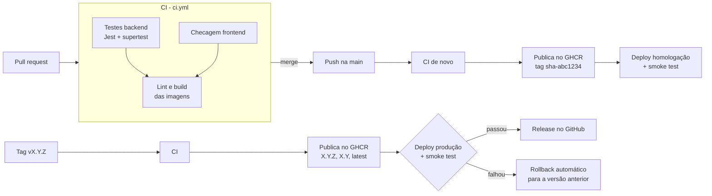

# DevOps do D.R.E.S.S. — Fase 2 (IaC e Entrega Contínua)

Este documento mostra onde está cada entrega da A2 e como usar.

| Entrega pedida | Onde está |
|---|---|
| Dockerfile otimizado | `D.R.E.S.S-main/backend/Dockerfile` e `D.R.E.S.S-main/frontend/Dockerfile` |
| Orquestração local | `docker-compose.yml` (MySQL + API + interface) |
| Pipeline de CD | `.github/workflows/cd.yml` (GHCR + deploy em homologação e produção) |
| Gestão de segredos | GitHub Environments + Secrets, sem senha no código (ver [Segredos](#segredos)) |
| Versionamento e rollback | tags `vX.Y.Z`, `CHANGELOG.md`, `scripts/deploy.sh` e `.github/workflows/rollback.yml` |

---

## Pipeline



| Evento | O que acontece |
|---|---|
| Pull request para `main` | CI: testes do backend, checagem do frontend, hadolint e build das duas imagens |
| Push na `main` (merge) | CI → imagens `sha-<commit>` e `main` no GHCR → deploy automático em **homologação** |
| Tag `v1.2.3` | CI → imagens `1.2.3`, `1.2` e `latest` → deploy em **produção** → release no GitHub |
| Actions → Rollback → Run workflow | Coloca no ar uma versão que já existe no GHCR |

### Ambientes simulados

Homologação e produção são **simulados**: o job sobe a aplicação com o mesmo
`docker-compose.yml` dentro do runner do GitHub Actions, baixando as imagens que
acabaram de ser publicadas no GHCR, e roda o smoke test. Num servidor de verdade
seria o mesmo `scripts/deploy.sh` executado lá (por SSH, por exemplo).

O smoke test (`scripts/smoke-test.sh`) confere:

1. `GET /health` responde `status: ok` e a **versão certa** (a do deploy)
2. login do admin funciona
3. uma rota protegida (`GET /produtos`) funciona com o token
4. a interface Streamlit responde

---

## Rodar local com Docker

```bash
cp .env.example .env        # preencha as senhas
docker compose up -d --build
```

- Interface: http://localhost:8501
- API: http://localhost:3000/health
- Login: o `ADMIN_USERNAME` / `ADMIN_PASSWORD` que você colocou no `.env`

Para parar: `docker compose down` (os dados ficam no volume `db_data`;
`docker compose down -v` apaga o banco também).

### O que tem de otimização nos Dockerfiles

- **Backend em duas etapas (multi-stage):** a imagem final não leva
  devDependencies (jest, nodemon) nem cache do npm.
- **Base pequena:** `node:20-alpine` e `python:3.12-slim`.
- **Cache de camadas:** os arquivos de dependência são copiados antes do
  código, então mudar o código não reinstala tudo.
- **`.dockerignore`:** não copia `node_modules`, testes nem `.env` para a imagem.
- **Usuário sem root** nos dois containers.
- **HEALTHCHECK** nos dois: o compose só sobe a interface depois que a API está
  saudável, e a API só depois que o MySQL está pronto.
- **Versão dentro da imagem:** o build recebe `APP_VERSION`, que aparece no `/health`.
- **Desligamento limpo:** a API trata o SIGTERM do `docker stop`.

---

## Segredos

Nenhuma senha fica no código. O que mudou para isso:

- antes o JWT tinha um segredo padrão (`segredo_dev`) no código e o admin era
  sempre `admin` / `123456`. Agora o servidor **não sobe** sem `JWT_SECRET`, e o
  primeiro admin vem de `ADMIN_PASSWORD`;
- o `docker-compose.yml` só tem referências (`${JWT_SECRET:?...}`). Se faltar
  algum segredo, o compose para com erro em vez de subir com senha vazia;
- o `.env` está no `.gitignore`; no repositório só existe o `.env.example`.

No pipeline os valores ficam nos **Secrets do GitHub Actions**
(Settings → Secrets and variables → Actions). Os jobs de deploy rodam nos
Environments `homologacao` e `producao`, então dá para ter um valor diferente
por ambiente cadastrando o secret dentro do Environment (Settings → Environments).

| Secret | Para que serve |
|---|---|
| `DB_PASSWORD` | senha do usuário da aplicação no MySQL |
| `DB_ROOT_PASSWORD` | senha do root do MySQL |
| `JWT_SECRET` | assinatura dos tokens de login |
| `ADMIN_PASSWORD` | senha do primeiro administrador |

O login no GHCR usa o `GITHUB_TOKEN` que o próprio Actions cria; não tem senha
de registry guardada. O GitHub esconde (`***`) qualquer secret que aparecer no log.

Para criar pelo terminal (cada comando pede o valor):

```bash
gh secret set JWT_SECRET
gh secret set ADMIN_PASSWORD
gh secret set DB_PASSWORD
gh secret set DB_ROOT_PASSWORD
```

---

## Versionamento semântico

Seguimos `MAJOR.MINOR.PATCH`:

- **PATCH** (1.1.**1**): correção de bug, sem mudar a API
- **MINOR** (1.**2**.0): funcionalidade nova compatível
- **MAJOR** (**2**.0.0): mudança que quebra quem usa a API

Para lançar uma versão:

```bash
# 1. atualizar a versão e o CHANGELOG.md
cd D.R.E.S.S-main/backend && npm version 1.2.0 --no-git-tag-version && cd -
# 2. commit (via PR na main)
# 3. criar a tag a partir da main, por um destes jeitos:
#    a) terminal
git checkout main && git pull
git tag v1.2.0
git push origin v1.2.0
#    b) interface: Releases > Draft a new release > Choose a tag > digite v1.2.0
#       > "Create new tag on publish" > target: main > Publish release
```

Pelos dois caminhos o CD roda igual. Quando a release é criada pela interface,
o pipeline só completa as notas dela com as imagens publicadas; se o deploy
falhar, ela vira pré-release com o aviso do rollback.

Cada versão gera estas imagens no GHCR:

```
ghcr.io/jpacouto/dress-backend:1.2.0     versão exata (usada no deploy e no rollback)
ghcr.io/jpacouto/dress-backend:1.2       última correção da 1.2
ghcr.io/jpacouto/dress-backend:latest    última versão estável
ghcr.io/jpacouto/dress-backend:sha-abc1234   cada commit da main
```

(e o mesmo para `dress-frontend`)

---

## Rollback

### Automático (no deploy de produção)

O `scripts/deploy.sh` sobe a versão nova e roda o smoke test. Se algo falhar
(container não fica saudável, versão errada, login quebrado), ele:

1. mostra os logs da API;
2. coloca no ar a **versão anterior** (a tag `vX.Y.Z` mais recente antes da atual);
3. confere a versão anterior com o smoke test;
4. termina com erro: o job fica vermelho e a release **não** é criada.

### Manual

**Actions → Rollback → Run workflow**, escolhendo o ambiente e a versão
(ex.: `1.1.0`). O workflow confere se a imagem existe no GHCR e faz o deploy dela.

Pelo terminal é o mesmo script com a versão antiga:

```bash
scripts/deploy.sh producao 1.1.0
```

### Simulação documentada

O que aconteceu no repositório, em ordem:

1. **v1.1.0:** release `v1.1.0` criada a partir da main. A mesma versão
   (imagem `sha-0771674`) já tinha passado no deploy de homologação com smoke
   test verde.
2. **Mudança de configuração:** o commit `2d76f4f` trocou o `ENV PORT` do
   Dockerfile do backend para **3001**, e dele saiu a release `v1.1.1`. O deploy
   da 1.1.1 **passou**, porque o `docker-compose.yml` define `PORT: 3000` para o
   container, e o valor do compose tem prioridade sobre o `ENV` da imagem. A porta
   errada só quebraria quem rodasse a imagem fora do compose.
3. **Rollback:** pelo workflow **Rollback** (Actions → Rollback → Run workflow),
   produção voltou para a imagem `sha-0771674`, que tem o mesmo código da v1.1.0.
   O script baixou a imagem do GHCR, subiu os containers, esperou o healthcheck e
   rodou o smoke test (`/health` ok com `versao: sha-0771674`, login e rota
   protegida ok).
   Execução: https://github.com/JPACouto/D.R.E.S.S/actions/runs/42035318488/job/127271833495
4. **Correção:** o PR #6 voltou o Dockerfile para `PORT=3000` (versão 1.1.2),
   para a imagem funcionar também fora do compose.

**Lição aprendida:** configuração duplicada (Dockerfile e compose) esconde erro.
O valor que vale no deploy é o do compose, então ele é a fonte única da porta, e
o smoke test confere a aplicação de fora do container, do jeito que o usuário acessa.

O rollback automático (quando o smoke test falha, o `scripts/deploy.sh` volta
para a tag anterior) está no mesmo script. Ele pode ser testado na máquina com o
roteiro abaixo, que usa uma falha que o compose não sobrepõe (o comando de
inicialização errado).

Para repetir na máquina, sem depender do GHCR (`BUILD_LOCAL=1` builda as imagens localmente):

```bash
set -a; source .env; set +a

# versão boa
BUILD_LOCAL=1 scripts/deploy.sh producao 1.1.0

# estraga o comando de inicialização de propósito
sed -i 's/"server.js"/"servidor.js"/' D.R.E.S.S-main/backend/Dockerfile
BUILD_LOCAL=1 scripts/deploy.sh producao 1.1.1     # falha e volta sozinho para a 1.1.0

# desfaz a alteração
git checkout D.R.E.S.S-main/backend/Dockerfile
```

---

## Estratégia de branches

Trunk-based: a `main` é o tronco e está sempre pronta para deploy.

- trabalho em branches curtas (`feat/...`, `fix/...`, `docs/...`, `chore/...`)
  que voltam para a `main` por pull request;
- a `main` é protegida: só entra por PR, com o CI verde;
- commits no padrão Conventional Commits (`feat:`, `fix:`, `docs:`, `test:`, `chore:`, `ci:`);
- versão publicada = tag `vX.Y.Z` na `main`.
